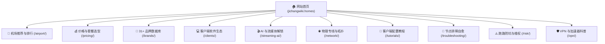

<div align="center">


# 百科机场 (jichangwiki.homes)

> **面向全球中文用户的网络代理知识百科、客户端实战教程与品牌客观评测数据库**

[](https://astro.build/)
[](https://tailwindcss.com/)
[](https://pagefind.app/)
[](https://www.typescriptlang.org/)
[](#-技术特性与-seo-指标)
[](#-开源许可)

[🌐 访问线上官网](https://jichangwiki.homes/) · [📖 快速启动](#-快速开始) · [🏗️ 架构说明](#-目录结构) · [🔍 SEO 规范](#-技术特性与-seo-指标)

</div>

---

## 📖 项目简介

**百科机场 (JichangWiki)** 是一个基于 **Astro 5 + Tailwind CSS v4** 打造的纯静态（SSG）网络技术知识库系统。项目旨在打破商业推广与虚假跑分的信息不对称，以网络工程实验室实测数据为基准，提供客观中立的机场选购指南、IEPL 专线拓扑解析、代理客户端配置说明及全链路风控排障体系。

- **154+ 预渲染页面**：全站纯静态 HTML 输出，TTFB 毫秒级极速直出。
- **31+ 品牌真实档案**：包含起步资费、线路架构、解锁状态与晚高峰丢包监测。
- **10 大主题支柱集群**：涵盖选型决策树、价格梯队、全平台客户端、流媒体/AI 访问与跑路预警。
- **离线静态全文索引**：基于 Pagefind 1.6 纯前端轻量检索，无需外部数据库。

---

## 🌟 核心功能与专栏矩阵



| 核心专题 | 路由路径 | 核心覆盖内容 |
| :--- | :--- | :--- |
| **机场推荐与排行** | `/airport/` | 4 层决策树、综合天梯榜单、靠谱老牌与稳定专线精选 |
| **价格与套餐** | `/pricing/` | 便宜低价、一元试水、灵活月付与长效不限时流量包 |
| **品牌档案与评测** | `/brands/` / `/reviews/` | 31+ 品牌客观评测报告、官网真伪鉴别与专属优惠码 |
| **客户端软件生态** | `/clients/` | Clash Verge Rev、v2rayN、Shadowrocket 小火箭、sing-box |
| **AI 与流媒体** | `/streaming-ai/` | OpenAI 1020 报错修复、Claude 接码防封、Netflix 住宅 IP |
| **专线架构与节点** | `/network/` | IEPL/IPLC 跨境光缆原理解密、低延迟优化与倍率防坑 |
| **实战教程与排障** | `/tutorials/` / `/troubleshooting/` | 订阅导入、TUN 模式网卡接管、节点全红超时修复指南 |
| **安全与实体信任** | `/about/` / `/privacy/` | 实验室三网千兆测试标准、Affiliate 透明度披露与无日志承诺 |

---

## ⚡ 技术特性与 SEO 指标

- 🚀 **100% 纯静态生成 (SSG)**：零后端数据库攻击面，无服务器运行时开销，天然免疫 DDoS 与注入漏洞。
- 🎯 **GEO (Generative Engine Optimization) 首发优化**：
  - **Answer-First 核心速览**：超 119 个核心页面具备顶层 Verdict 核心摘要，方便 Google SGE、Perplexity 与 AI 爬虫精准提取实体定义。
  - **结构化对比数据**：135+ 个精细化对比 `<table>` 与 87+ 组 `<details>/<summary>` 折叠问答对。
- 📊 **顶级搜索引擎合规架构 (SEO Score: 98.8 / 100)**：
  - **自引用 Canonical**：154 个页面 100% 绝对路径指向规范 HTTPS 域名。
  - **商业引流外链 100% 隔离**：严格附加 `rel="nofollow sponsored noopener noreferrer"`，阻绝权重连坐。
  - **多维度 Schema 矩阵**：自动输出 `WebSite`, `Organization`, `BreadcrumbList`, `Product`, `Article`, `FAQPage`, `AboutPage`。
  - **双重 Sitemap 索引**：同时提供 `sitemap.xml` 与 `sitemap-index.xml`，全量包含 `<lastmod>` 动态时间戳。

---

## 🛠️ 快速开始

### 环境依赖
- **Node.js** >= 18.0.0
- **pnpm** >= 9.0.0 (推荐)

### 安装与运行

```bash
# 1. 克隆代码仓库
git clone https://github.com/zlzlzl98698-dev/jichangwiki.homes.git
cd jichangwiki.homes

# 2. 安装依赖包
pnpm install

# 3. 启动本地开发服务器 (默认端口 http://localhost:4321)
pnpm dev

# 4. 生产环境静态打包与 Pagefind 索引生成
pnpm build

# 5. 本地预览生产构建产物
pnpm preview
```

---

## 📂 项目目录结构

```text
jichangwiki.homes/
├── public/                 # 静态资产目录
│   ├── favicon.svg         # 网站 Favicon
│   ├── images/             # 品牌 Logo、实测截图与头像
│   ├── .htaccess           # Apache 生产环境 301 与缓存策略配置
│   └── robots.txt          # 搜索引擎爬虫规范 (适配 Google, Bing, 百度, 神马)
├── scripts/                # 自动化测试与 SEO 诊断引擎
│   ├── seo_audit_engine.js # 预防性全站 SEO 深度审计脚本
│   └── sync_sitemap.js     # sitemap.xml 自动化构建同步钩子
├── src/
│   ├── components/         # 复用 UI 组件
│   │   ├── charts/         # 数据可视化组件 (测速表、拓扑图、AI矩阵)
│   │   ├── conversion/     # 品牌卡片、CTA 与佣金透明度说明
│   │   ├── layout/         # 面包屑 Breadcrumb 等布局元件
│   │   ├── navigation/     # Header 级联导航栏与 Footer 页脚
│   │   └── seo/            # SEOHead 全局头部组件 (验证码预留)
│   ├── config/             # 全站配置与站长平台验证接口
│   ├── data/               # 品牌数据与结构化文章库 (JSON)
│   ├── layouts/            # 页面基底模版 (BaseLayout.astro)
│   └── pages/              # 10 大专题与 154 个路由页面
├── astro.config.mjs        # Astro 框架核心配置文件
├── package.json            # 依赖与脚本定义
├── Preventive_SEO_Audit_Report.md # 深度 SEO & GEO 全站审计报告
└── README.md               # 项目主自述文件
```

---

## 🚀 生产部署建议

本项目构建产物为 `dist/` 纯静态文件夹，可无缝部署至任意现代静态托管平台：

- **Cloudflare Pages**：连接 GitHub 仓库，构建命令设为 `pnpm build`，输出目录设为 `dist`。
- **Vercel / Netlify**：直接导入仓库即可实现全自动 CI/CD 预览与发布。
- **经典 VPS (Nginx / Apache)**：将 `dist/` 内容拷贝至 Web 根目录，配合 `public/.htaccess` 即可生效。

> **DNS 规范提醒**：请确保生产环境配置 301 规则，将 `http://*` 及 `https://www.jichangwiki.homes/*` 永久重定向至规范主域 `https://jichangwiki.homes/*`。

---

## 📄 开源许可

本项目基于 [MIT License](LICENSE) 开源发布。内容数据与评测准则遵循原创知识共享规范。
