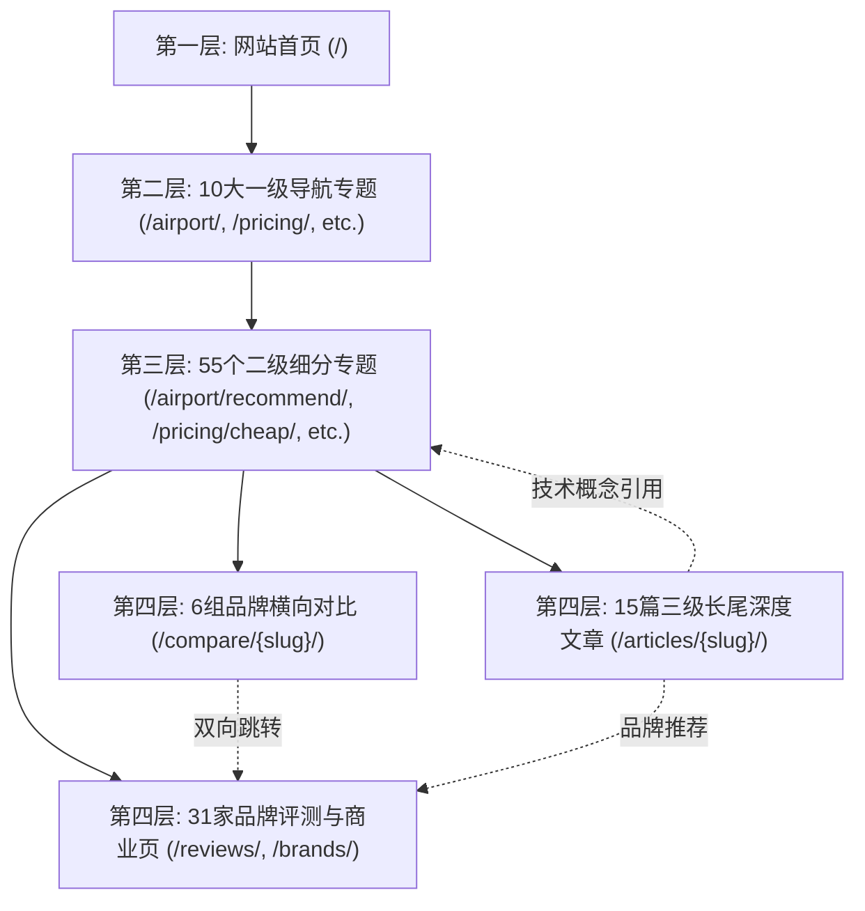

# 全站三级网状内链拓扑与面包屑层级矩阵报告

- **报告生成时间**: 2026-11-22
- **架构目标**: 打造无死角、高相关度、四层递进的权重传递闭环网络

---

## 一、 四层立体内链拓扑架构

1. **父子垂直链路（Downward/Upward Linking）**：
   - 每一级页面均有清晰的向上回退链路（通过面包屑与专题标签）；
   - 上级页面通过聚合列表、最新文章卡片自然向下分发权重。
2. **横向同级互链（Lateral Linking）**：
   - 三级文章之间通过“相关推荐”、“下步操作”进行横向关联（例如：Clash 配置教程文章内链至“注册表残留清理脚本”）；
   - 品牌对比页直接互链至对应的两家单品牌评测页。
3. **商业转化对流（Commercial Conversion Loop）**：
   - 百科教程文章在阐释协议或故障时，在底部自然呈现“实测抗封锁专线品牌（光速云）”，引导商业转化；
   - 商业详情页提供反向链接至“如何配置客户端”与“如何挑选稳定机场”等科普文章。

---

## 二、 面包屑导航（Breadcrumbs）规范

全站所有子页面强制挂载面包屑，统一格式规范：
- 三级文章: `首页 > [一级专题名称] > [二级专题名称] > [文章标题简写]`
- 品牌对比: `首页 > 机场对比 > [品牌A] vs [品牌B] 深度横向对比`
- 品牌评测: `首页 > 品牌评测 > [品牌名称] 真实使用评测与优缺点`
- 品牌详情: `首页 > 品牌大全 > [品牌名称] 官网、套餐与注册入口`

全站面包屑代码均自动注入 Google 推荐的 `BreadcrumbList` 结构化数据，确保搜索结果摘要中呈现清晰的面包屑路径。
