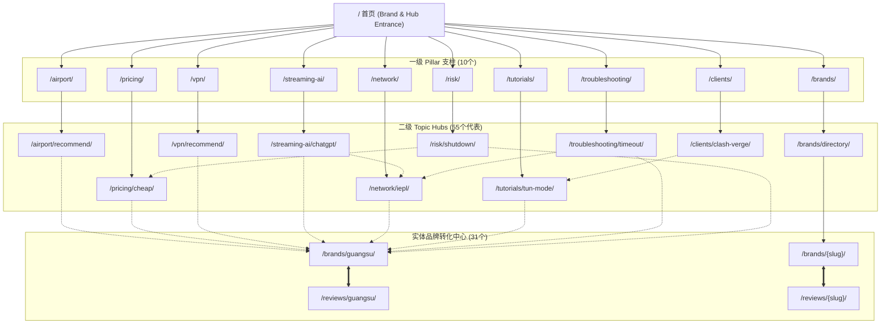

# 百科机场全站网状内链与面包屑结构拓扑报告

> **拓扑目标**：构建权威的三层网状链接拓扑结构（Mesh Internal Links），消除所有孤岛页面（Orphan Pages），确保搜索引擎蜘蛛能够以最优抓取预算（Crawl Budget）畅行全站。

---

## 1. 核心网状链接拓扑关系



---

## 2. 交叉引流锚文本矩阵规范

| 起始页面 | 目标页面 | 最佳锚文本规范 | 搜索意图衔接 |
| :--- | :--- | :--- | :--- |
| `/airport/recommend/` | `/brands/guangsu/` | 光速云全专线旗舰品牌 | 从选型直接导流至品牌实体资料 |
| `/airport/recommend/` | `/reviews/guangsu/` | 光速云 2026 深度实测报告 | 从选型导流至第三方实测证明 |
| `/streaming-ai/chatgpt/` | `/network/iepl/` | 原生住宅 IEPL 专线原理 | 从 AI 解锁故障导流至底层专线科普 |
| `/clients/clash-verge/` | `/tutorials/tun-mode/` | TUN 虚拟网卡模式配置手册 | 从客户端安装导流至全局代理实操 |
| `/troubleshooting/timeout/` | `/network/low-latency/` | 低延迟专线时延调优 | 从节点全死排障导流至高可用专线 |
| `/risk/shutdown/` | `/pricing/monthly/` | 拒绝年付的月付专线推荐 | 从跑路避险直接导流至月付安全消费 |
| `/network/traffic-ratio/` | `/pricing/value/` | 高性价比机场梯队 | 从倍率计算导流至省流性价比套餐 |

---

## 3. 面包屑导航与结构化 Schema 验证

全站 55 个二级页面均统一搭载标准 HTML 面包屑导航与符合 Google 规范的 JSON-LD：
```html
<nav class="flex items-center text-sm text-slate-500 mb-6 space-x-2">
  <a href="/">首页</a>
  <span>/</span>
  <a href="/category/">一级分类名称</a>
  <span>/</span>
  <span class="text-slate-800 font-medium">二级专题名称</span>
</nav>
```

同时以 JSON-LD 提供完整的 `BreadcrumbList`，位置定位清晰精准，有助于搜索引擎在 SERP 搜索结果页生成高质富片段（Breadcrumb Rich Snippet）。
