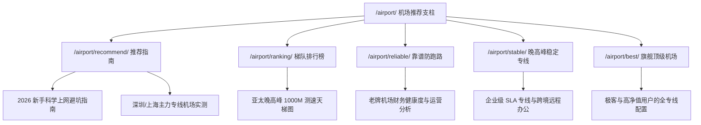
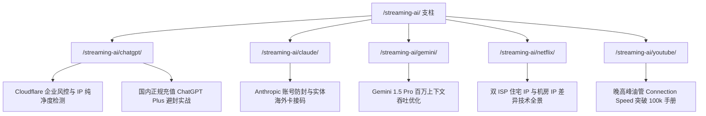
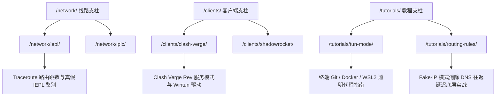
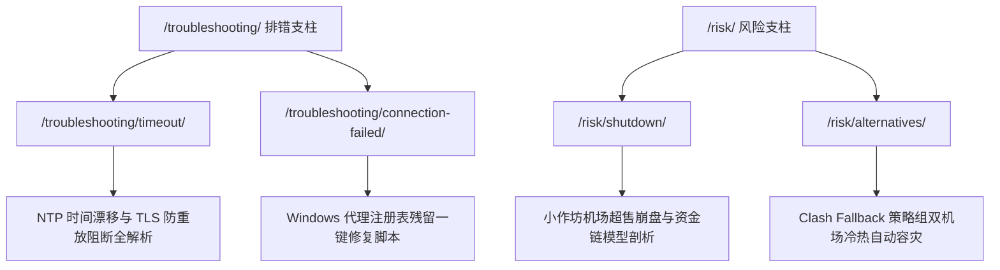

# 百科机场二级专题集群与三级文章集群规划架构

> **架构层级**：一级支柱（Pillar） → 二级专题枢纽（Topic Hub） → 三级深度长尾文章（Cluster Article）

---

## 集群 1：商业推荐与选购转化闭环 (/airport/ & /pricing/)

### 价值闭环：
- 用户搜索“机场推荐”进入 `/airport/recommend/` 查看 Answer-First 评级；
- 点击品牌卡片进入单品牌详情（`/brands/guangsu/`）或深度评测（`/reviews/guangsu/`）；
- 从评测页面的价格表直接点击合规赞助链接完成注册，形成商业闭环。

---

## 集群 2：前沿 AI 生产力与影音娱乐闭环 (/streaming-ai/)

---

## 集群 3：硬核线路、协议与客户端技术基石 (/network/ & /clients/ & /tutorials/)

---

## 集群 4：网络急救、排错与资产避险体系 (/troubleshooting/ & /risk/)

